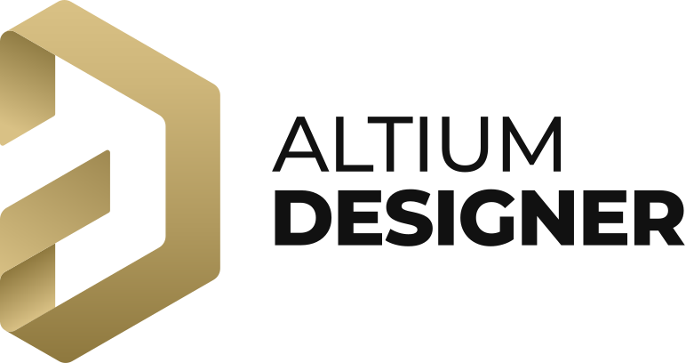
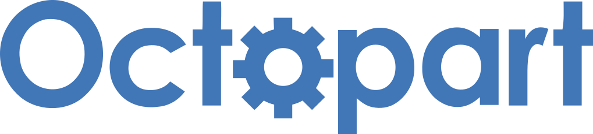
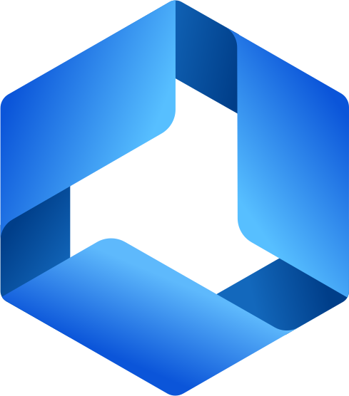

<picture>
  <source media="(prefers-color-scheme: dark)" srcset="https://raw.githubusercontent.com/AltiumDeveloper/.github/main/profile/static/A20-Altium-Logo_A365-Horiz-Lt.svg">
  
</picture>
&nbsp;&nbsp;&nbsp;
<picture>
  <source media="(prefers-color-scheme: dark)" srcset="https://raw.githubusercontent.com/AltiumDeveloper/.github/main/profile/static/AD-logo-horizontal-WHT.svg">
  
</picture>
&nbsp;&nbsp;&nbsp;

### Build on Altium: electronics design data, EDA extensions and component supply intelligence.

This is the public engineering home of the [Altium Developer Center](https://developer.altium.com/): SDKs, API references, tools and samples for the three Altium developer surfaces.

| | Surface | Use it to… | Start here |
|:-:|---|---|---|
|  | **[Altium 365 API](#altium-365-api)** | Read and act on workspace data such as projects, BOMs, components and design reviews, from your own apps, scripts and integrations | [Quick start](https://www.altium.com/documentation/altium-developer-center/quick-starts/365-api) · [Reference](https://docs.developer.altium.com/platform-api-docs/) |
|  | **[Altium Designer SDK](#altium-designer-sdk)** | Extend Altium Designer with your own commands, panels and automation | [Quick start](https://www.altium.com/documentation/altium-developer-center/quick-starts/ad-sdk) · [Template](https://github.com/AltiumDeveloper/ad-extension-template) · [Reference](https://docs.developer.altium.com/ad-sdk-docs/) |
|  | **[Octopart API](#octopart-api)** | Search parts and get pricing, stock, lifecycle and specs across distributors | [Quick start](https://www.altium.com/documentation/altium-developer-center/quick-starts/octopart-api) · [Reference](https://docs.developer.altium.com/octopart-api-docs/) |

### Building with AI assistants?

All integration surfaces publish an `llms.txt` you can point your coding agent at:
[Altium 365 API](https://docs.developer.altium.com/platform-api-docs/llms.txt) · [Altium Designer SDK](https://docs.developer.altium.com/ad-sdk-docs/llms.txt) · [Octopart API](https://docs.developer.altium.com/octopart-api-docs/llms.txt)

---

## Platform foundations

These shared building blocks sit underneath all three surfaces.

| Project | What it gives you |
|---|---|
| [**cdm**](https://github.com/AltiumDeveloper/cdm) | **Altium Common Data Model**: the LinkML schema that describes electronics design entities across Altium products. [Browse the model](https://docs.developer.altium.com/cdm/) |
| [**altium-auth**](https://github.com/AltiumDeveloper/altium-auth) | Client libraries for Altium sign-in (OAuth2/OIDC + PKCE, desktop flow, workspace token exchange, Gov Cloud), built against one shared spec. [Docs](https://docs.developer.altium.com/altium-auth/) |

---

## Altium 365 API

A GraphQL API over Altium 365 workspaces, cross-linked with the [Common Data Model](https://docs.developer.altium.com/cdm/).

**Explore:** [API reference](https://docs.developer.altium.com/platform-api-docs/) · [Voyager schema explorer](https://eur.365.altium.com/api/voyager) · [GraphQL playground](https://eur.365.altium.com/api/graphql/) · [Product docs](https://www.altium.com/documentation/altium-developer-center/altium-365/api)

| Project | What it gives you |
|---|---|
| [**platform-api-docs**](https://github.com/AltiumDeveloper/platform-api-docs) | Source of the Altium 365 API reference. Issues and suggestions are welcome. |
| [**a365-vscode-extension**](https://github.com/AltiumDeveloper/a365-vscode-extension) | Browse workspaces and run or debug Python scripts against live data without leaving VS Code. [Install from the Marketplace](https://marketplace.visualstudio.com/items?itemName=altium.developer) |
| [**a365-erc-sdk**](https://github.com/AltiumDeveloper/a365-erc-sdk) | Write custom Electrical Rule Checks in Python and run them in Altium 365. [Docs](https://docs.developer.altium.com/a365-erc-sdk/) |
| [**plm-integration-sdk-cs**](https://github.com/AltiumDeveloper/plm-integration-sdk-cs) | Build a custom PLM connector between your PLM system and an Altium 365 workspace (C#, gRPC). [Docs](https://docs.developer.altium.com/plm-integration-sdk-cs/) |
| [**platform-api-first-query**](https://github.com/AltiumDeveloper/platform-api-first-query) | "Hello Workspace" plus use-case samples. Start here for your first query. |
| [**platform-api-demo**](https://github.com/AltiumDeveloper/platform-api-demo) | A full web app built on the design API (Blazor). [Live demo](https://a365-api-demo.intdev.altium.com/) |

## Altium Designer SDK

A .NET SDK for building Altium Designer extensions. 

**Explore:** [SDK reference](https://docs.developer.altium.com/ad-sdk-docs/) · [Quick start](https://www.altium.com/documentation/altium-developer-center/quick-starts/ad-sdk)

> [!TIP] 
> **Start a new extension in one command:** [**ad-extension-template**](https://github.com/AltiumDeveloper/ad-extension-template) scaffolds a complete C# extension with `dotnet new ad-extension`, and **hot-reloads your code while Altium Designer keeps running**: no reinstall, no restart.

| Project | What it gives you |
|---|---|
| [**ad-extension-template**](https://github.com/AltiumDeveloper/ad-extension-template) | `dotnet new` template and hot-reload host for Altium Designer extensions. Edit, build, and your new code runs in seconds. [NuGet](https://www.nuget.org/packages/Altium.Designer.Extension.Templates) |
| [**ad-sdk-docs**](https://github.com/AltiumDeveloper/ad-sdk-docs) | Source of the SDK API reference. Issues and suggestions are welcome. |

## Octopart API

A GraphQL API for electronic component supply data: parts, offers, pricing, stock and specs.

**Explore:** [API reference](https://docs.developer.altium.com/octopart-api-docs/) · [Voyager schema explorer](https://api.nexar.com/ui/voyager) · [GraphQL playground](https://api.nexar.com/graphql/) · [Product docs](https://www.altium.com/documentation/altium-developer-center/octopart/api)

| Project | What it gives you |
|---|---|
| [**octopart-api-docs**](https://github.com/AltiumDeveloper/octopart-api-docs) | Source of the Octopart API reference. Issues and suggestions are welcome. |
| [**stock-locator-tool**](https://github.com/AltiumDeveloper/stock-locator-tool) | Embed live part search, offers and stock levels in your own site with this React component. [Guide](https://www.altium.com/documentation/altium-developer-center/octopart/stock-locator-tool) |
| [**octopart-api-demo**](https://github.com/AltiumDeveloper/octopart-api-demo) | A full web app built on the supply API (Blazor). [Live demo](https://octopart-api-demo.intdev.altium.com/) |

---

## Get help & get involved

- **Questions and discussion:** the [Altium Developer forum](https://forum.live.altium.com/#/forums/100271), or GitHub Discussions on the repo you're using.
- **Bugs and feature requests:** open an issue on the relevant repository. See [SUPPORT](https://github.com/AltiumDeveloper/.github/blob/main/SUPPORT.md) for where each kind of request goes.
- **Security issues:** please don't open a public issue. Follow our [security policy](https://github.com/AltiumDeveloper/.github/blob/main/SECURITY.md).
- **Contributing:** read [CONTRIBUTING](https://github.com/AltiumDeveloper/.github/blob/main/CONTRIBUTING.md) and our [Code of Conduct](https://github.com/AltiumDeveloper/.github/blob/main/CODE_OF_CONDUCT.md).

Altium, Altium 365, Altium Designer and Octopart are trademarks of Altium. See <a href="https://www.altium.com/copyrights-and-trademarks">Copyrights &amp; Trademarks</a>. Code in each repository is provided under that repository's license.
